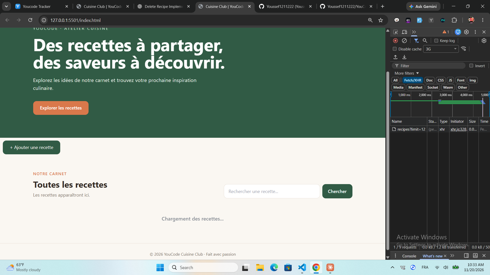
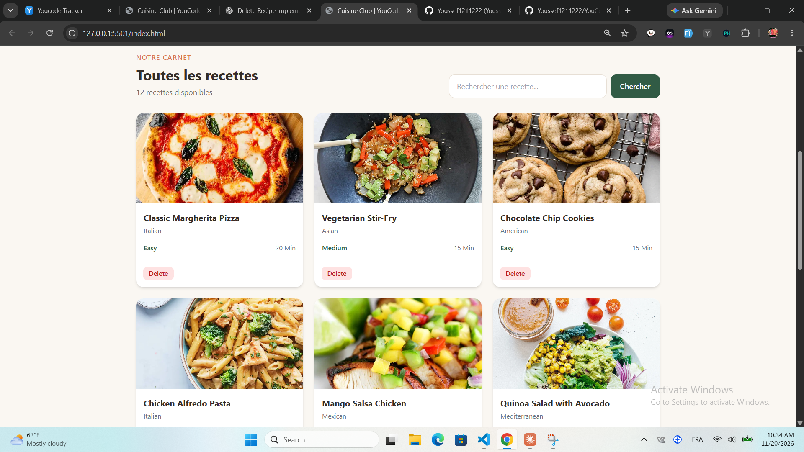
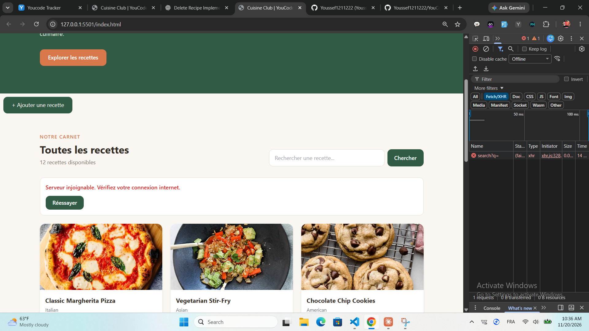
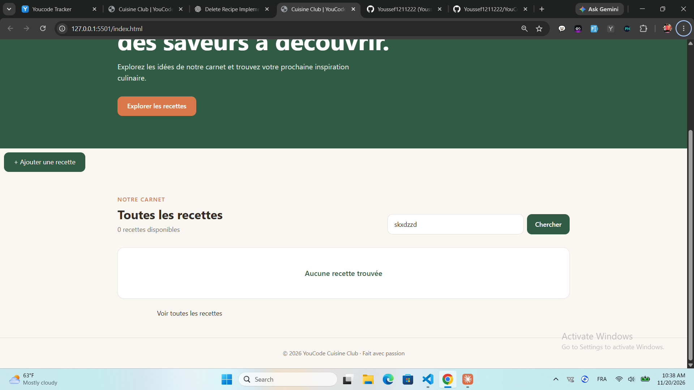

# YouCode Cuisine Club (Axios)

Application web pour parcourir, rechercher, ajouter et supprimer des recettes, connectée à l'API publique [DummyJSON](https://dummyjson.com/docs/recipes) avec **Axios** (sans `fetch`).

- **Démo (GitHub Pages)** : `https://Youssef1211222.github.io/YouCode-Cuisine-Club-Axios/`
- **Dépôt GitHub** : `https://github.com/Youssef1211222/YouCode-Cuisine-Club-Axios`

## Technologies

HTML5, Tailwind CSS (CDN), JavaScript (ES6, `async/await`), Axios (CDN).

## Structure du projet

```
index.html
js/
  api.js
  validation.js
  ui.js
  script.js
screenshots/
README.md
```

## Rôle de chaque fichier

| Fichier | Rôle |
|---|---|
| `index.html` | Structure de la page : en-tête, section d'accueil, recherche, liste des recettes, loader, zone de message, modale d'ajout, dialogues de confirmation et de succès. |
| `js/api.js` | **Tous les appels API** (Axios). Contient l'instance Axios, les 4 fonctions (`getRecipes`, `searchRecipes`, `ajouterRecette`, `supprimerRecette`) et la gestion des erreurs avec `try/catch` (`messageErreur`). |
| `js/validation.js` | Fonctions de validation du formulaire d'ajout (`validerNom`, `validerCuisine`, `validerDifficulte`, `validerTemps`). |
| `js/ui.js` | **Affichage** : cartes de recettes, compteur, loader, message d'erreur avec bouton « Réessayer », confirmation et exécution de la suppression. |
| `js/script.js` | **Logique principale** : `executerRequete` (loader + erreurs + retry), initialisation, recherche, ouverture/fermeture de la modale, validation et ajout d'une recette. |

## Tableau des requêtes API

Base URL : `https://dummyjson.com` (timeout : 5 s)

| Fonction | Méthode | URL | Données envoyées | Réponse |
|---|---|---|---|---|
| `getRecipes()` | GET | `/recipes?limit=12` | Aucune | `{ recipes: [...], total, skip, limit }` : on utilise `recipes` (12 recettes) |
| `searchRecipes(query)` | GET | `/recipes/search?q=<terme>` | Paramètre `q` (encodé avec `encodeURIComponent`) | `{ recipes: [...], total, ... }` : tableau vide si aucun résultat |
| `ajouterRecette(recette)` | POST | `/recipes/add` | `{ name, cuisine, difficulty, prepTimeMinutes }` | La recette envoyée + un `id` généré par l'API |
| `supprimerRecette(id)` | DELETE | `/recipes/{id}` | Aucune (l'id est dans l'URL) | La recette supprimée avec `isDeleted: true` et `deletedOn` |

### Codes d'erreur gérés

| Situation | Détection | Message affiché |
|---|---|---|
| Serveur injoignable / hors ligne / timeout | Aucune `error.response` | « Serveur injoignable. Vérifiez votre connexion internet. » |
| Recette introuvable | Statut 404 | « Recette introuvable (404). » |
| Erreur serveur | Statut ≥ 500 | « Erreur du serveur (500). Veuillez réessayer plus tard. » |
| Autre erreur HTTP | Autre statut | « Une erreur est survenue (statut). » |

Dans tous les cas, le loader est masqué (`finally`) et un bouton **« Réessayer »** relance la dernière requête.

## Limites de l'API de démonstration

DummyJSON est une API **factice** :

- `POST /recipes/add` et `DELETE /recipes/{id}` **ne modifient pas réellement les données** du serveur : l'API simule l'opération et renvoie une réponse.
- Une recette ajoutée **disparaît après rechargement** de la page.
- Une recette supprimée **réapparaît après rechargement**.
- L'id renvoyé lors d'un ajout est fictif : supprimer une recette ajoutée peut donner une erreur 404.
- La recette ajoutée n'a pas d'image (l'API n'en renvoie pas).

## Scénarios de test manuels

| # | Scénario | Étapes | Résultat attendu |
|---|---|---|---|
| 1 | Chargement | Ouvrir la page avec le throttling « Slow 3G » | « Chargement des recettes... » s'affiche puis disparaît |
| 2 | Liste | Ouvrir la page | 12 cartes affichées, compteur « 12 recettes disponibles » |
| 3 | Recherche avec résultats | Saisir « pizza » puis « Chercher » | Les recettes correspondantes s'affichent, compteur mis à jour, bouton « Voir toutes les recettes » |
| 4 | Recherche vide | Saisir « zzzzz » puis « Chercher » | Message « Aucune recette trouvée » et bouton « Voir toutes les recettes » |
| 5 | Ajout invalide | Ouvrir la modale, laisser les champs vides (ou nom < 3 caractères, temps = 0 ou > 300) et valider | Messages d'erreur sous les champs concernés, **aucune requête POST** dans l'onglet Network |
| 6 | Ajout valide | Remplir tous les champs correctement et valider | Requête POST visible, popup de succès, nouvelle carte en tête de liste |
| 7 | Suppression | Cliquer « Delete » puis confirmer | Requête DELETE visible, la carte disparaît, popup de succès |
| 8 | Erreur 404 | Supprimer une recette avec un id inexistant (ex. `recetteIdASupprimer = 99999` dans la console) | Message « Recette introuvable (404). » + bouton « Réessayer » |
| 9 | Erreur 500 | Remplacer temporairement l'URL de `getRecipes` par `https://httpbin.org/status/500` | Message « Erreur du serveur (500). » + bouton « Réessayer » |
| 10 | Hors ligne | DevTools > Network > « Offline », puis « Chercher » | Message « Serveur injoignable. » ; après retour du réseau, « Réessayer » recharge les données |

## Captures d'écran

| Chargement | Liste des recettes |
|---|---|
|  |  |

| Erreur | Aucun résultat |
|---|---|
|  |  |

## Lancer le projet en local

Ouvrir le dossier avec VS Code et lancer **Live Server** sur `index.html`, ou ouvrir directement `index.html` dans le navigateur.